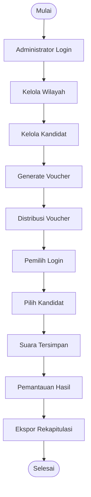

 <div align="center">

# 🗳️ VOTING TOOLS IPM

### Digital Voting Platform for Ikatan Pelajar Muhammadiyah

**Mewujudkan proses demokrasi digital yang lebih praktis, transparan, dan terorganisir.**

[](https://www.python.org/)
[](https://fastapi.tiangolo.com/)
[](https://www.mysql.com/)
[](./)

[**Repository**](https://github.com/HafidzX-dev/Voting-tools-IPM) · [**Setup Guide**](README-SETUP.md) · [**Report Bug**](https://github.com/HafidzX-dev/Voting-tools-IPM/issues)

</div>

---

## 📖 Tentang Proyek

**Voting Tools IPM** merupakan platform pemungutan suara elektronik (*electronic voting / e-voting*) yang dikembangkan untuk mendukung pelaksanaan pemilihan dalam lingkungan **Ikatan Pelajar Muhammadiyah (IPM)**.

Aplikasi ini dirancang untuk membantu panitia menyelenggarakan proses pemilihan secara digital, mulai dari pengelolaan wilayah, pendataan kandidat, pembuatan voucher pemilih, hingga pemantauan dan rekapitulasi hasil suara.

Dengan memanfaatkan teknologi berbasis web, Voting Tools IPM menghadirkan sistem pemilihan yang lebih terstruktur dan mudah diakses melalui komputer maupun perangkat mobile.

### 🎯 Tujuan Pengembangan

- Digitalisasi proses pemilihan di lingkungan IPM.
- Mempermudah panitia dalam mengelola data pemilih dan kandidat.
- Mengurangi risiko pemungutan suara ganda.
- Mempercepat proses penghitungan dan rekapitulasi suara.
- Meningkatkan keteraturan administrasi dan dokumentasi pemilihan.

---

## ✨ Fitur Utama

### 🗳️ Sistem Pemungutan Suara
- Antarmuka pemilihan berbasis web.
- Sistem autentikasi menggunakan voucher pemilih.
- Validasi pemilih untuk mencegah penggunaan voucher secara berulang.
- Pemantauan hasil perolehan suara secara real-time.

### 👥 Manajemen Kandidat
- Menambahkan dan mengelola data kandidat.
- Mengunggah foto kandidat.
- Mengatur urutan tampilan kandidat.
- Mengelola kandidat aktif dalam proses pemilihan.

### 🎟️ Manajemen Voucher Pemilih
- Generate voucher secara otomatis.
- Pengaturan jumlah voucher berdasarkan wilayah.
- Pengaturan kuota pemilih.
- Pencetakan voucher untuk didistribusikan kepada pemilih.
- Pengelolaan dan pemulihan voucher.

### 🏢 Manajemen Wilayah
- Menambahkan wilayah pemilihan.
- Menggunakan kode pos sebagai identitas wilayah.
- Mengelompokkan data pemilih berdasarkan wilayah.
- Mengatur distribusi voucher pada masing-masing wilayah.

### 📊 Hasil dan Rekapitulasi
- Pemantauan perolehan suara.
- Rekapitulasi hasil pemilihan.
- Ekspor hasil ke format Excel.
- Pencatatan aktivitas melalui sistem log.

### 🔐 Keamanan Sistem
- Validasi penggunaan voucher.
- Pembatasan percobaan autentikasi untuk mengurangi brute-force.
- Penguncian voucher sementara setelah beberapa kali kesalahan autentikasi.
- Pengelolaan akun administrator.
- Konfigurasi rahasia melalui environment variables.

---

## 🛠️ Tech Stack

Teknologi yang digunakan dalam pengembangan Voting Tools IPM:

| Teknologi | Kegunaan |
|:---|:---|
| Python | Bahasa pemrograman utama |
| FastAPI | Backend web framework |
| SQLAlchemy | Object Relational Mapper |
| MySQL | Database management system |
| PyMySQL | Koneksi Python dengan MySQL |
| Uvicorn | ASGI application server |
| Bcrypt | Password hashing |
| OpenPyXL | Pengolahan dan ekspor Excel |
| Python Dotenv | Pengelolaan environment variables |
| Nginx | Web server dan reverse proxy |
| Ubuntu Server | Lingkungan deployment |

---

## 📂 Struktur Repository

```text
Voting-tools-IPM/
│
├── app/
│   ├── static/
│   │   └── assets/
│   │       └── logo.png
│   │
│   └── ...                 # Aplikasi utama
│
├── deploy/
│   ├── voting.service      # Systemd service
│   └── voting-nginx.conf   # Konfigurasi Nginx
│
├── .gitignore
├── README.md               # Dokumentasi proyek
├── README-SETUP.md         # Panduan instalasi dan deployment
└── requirements.txt        # Python dependencies
```

---

## 🚀 Instalasi dan Menjalankan

### 1. Persyaratan

Pastikan perangkat telah memiliki:

- Python 3.8 atau lebih baru.
- Git.
- MySQL Server.
- pip.
- Sistem operasi Linux (disarankan Ubuntu Server untuk deployment).

### 2. Clone Repository

```bash
git clone https://github.com/HafidzX-dev/Voting-tools-IPM.git

cd Voting-tools-IPM
```

### 3. Membuat Virtual Environment

```bash
python3 -m venv venv
```

Aktifkan virtual environment:

**Linux / Ubuntu:**

```bash
source venv/bin/activate
```

**Windows:**

```powershell
venv\Scripts\activate
```

### 4. Install Dependencies

```bash
pip install -r requirements.txt
```

### 5. Konfigurasi Environment

Siapkan konfigurasi `.env` berdasarkan `.env.example` yang tersedia pada deployment aplikasi.

Konfigurasi utama yang diperlukan:

```env
DATABASE_URL=your_database_connection
SECRET_KEY=your_secret_key
```

> **Penting:** Gunakan kredensial database dan secret key yang kuat. Jangan pernah mengunggah file `.env` atau informasi autentikasi ke repository publik.

### 6. Menjalankan Aplikasi

Untuk konfigurasi dan menjalankan aplikasi, ikuti panduan teknis yang telah disediakan:

📘 **[README-SETUP.md — Installation & Deployment Guide](README-SETUP.md)**

Panduan tersebut mencakup konfigurasi MySQL, systemd service, Nginx, serta pengaturan administrator.

---

## 🖥️ Deployment

Voting Tools IPM telah menyediakan direktori `deploy/` untuk membantu proses deployment pada Ubuntu Server.

Komponen deployment:

| Komponen | Fungsi |
|:---|:---|
| Ubuntu Server | Sistem operasi server |
| MySQL Server | Penyimpanan data |
| Python Virtual Environment | Isolasi dependencies |
| Systemd | Pengelolaan service aplikasi |
| Nginx | Reverse proxy dan web server |

Setelah deployment berhasil, aplikasi dapat diakses melalui:

| Halaman | Endpoint |
|:---|:---|
| Halaman Pemilih | `http://IP-SERVER/` |
| Panel Administrator | `http://IP-SERVER/admin` |

Sesuaikan alamat tersebut dengan konfigurasi server yang digunakan.

---

## 🔄 Alur Penggunaan

Berikut gambaran umum proses penggunaan aplikasi:



---

## 🔒 Catatan Keamanan

Untuk menjaga integritas penyelenggaraan pemilihan, perhatikan hal-hal berikut:

1. Segera ubah seluruh password administrator bawaan sebelum aplikasi digunakan.
2. Gunakan password database yang kuat.
3. Pastikan file `.env` tidak masuk ke Git.
4. Gunakan HTTPS ketika aplikasi diakses melalui jaringan publik.
5. Lakukan backup database secara berkala.
6. Batasi akses panel administrator kepada pihak yang berwenang.
7. Lakukan pengujian keamanan dan audit sistem sebelum digunakan untuk pemilihan resmi.

**Catatan:** Sistem ini merupakan perangkat pendukung pemilihan digital. Penggunaan untuk pemilihan resmi tetap memerlukan pengujian, audit, dan prosedur pengawasan yang sesuai.

---

## 🤝 Kontribusi

Kontribusi dari komunitas developer sangat terbuka untuk membantu pengembangan Voting Tools IPM.

Jika ingin berkontribusi:

1. Fork repository ini.
2. Buat branch baru.

```bash
git checkout -b feature/nama-fitur
```

3. Lakukan perubahan dan pengembangan.
4. Commit perubahan.

```bash
git add .
git commit -m "feat: menambahkan fitur baru"
```

5. Push branch.

```bash
git push origin feature/nama-fitur
```

6. Buat Pull Request ke repository utama.

---

## 🗺️ Pengembangan Selanjutnya

Beberapa aspek yang dapat dikembangkan lebih lanjut:

- [ ] Penyempurnaan dashboard administrator.
- [ ] Pengembangan sistem pelaporan hasil pemilihan.
- [ ] Peningkatan sistem audit dan keamanan.
- [ ] Dokumentasi API yang lebih lengkap.
- [ ] Otomatisasi backup database.
- [ ] Pengembangan sistem monitoring server.

---

## 👨‍💻 Developer

<div align="center">

### HafidzX-dev

**Developer & Maintainer**

[](https://github.com/HafidzX-dev)
[](https://instagram.com/hafidzx_iiey)
[](https://youtube.com/@HafidzX)

</div>

---

## 📄 Lisensi

Silakan merujuk pada ketentuan lisensi yang berlaku di repository ini. Pastikan file lisensi ditambahkan sebelum mendistribusikan proyek sebagai software open-source.

---

<div align="center">

### 💛 Built for Digital Democracy

Dikembangkan untuk mendukung transformasi digital dan kemajuan demokrasi di lingkungan Ikatan Pelajar Muhammadiyah.

**Nūn. Wal-qalami wa mâ yasthurûn.**

⭐ Jika proyek ini bermanfaat, jangan lupa berikan Star pada repository!

[⬆ Kembali ke Atas](#-voting-tools-ipm)

</div>
